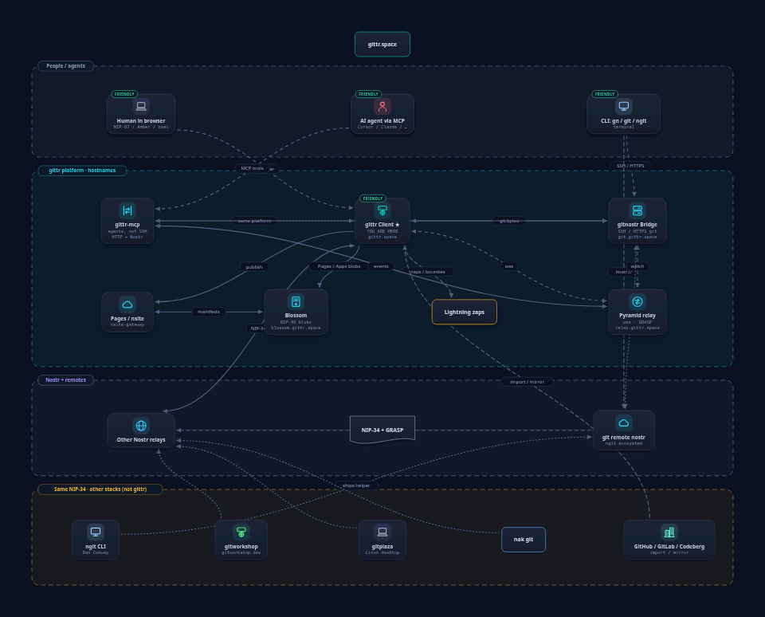
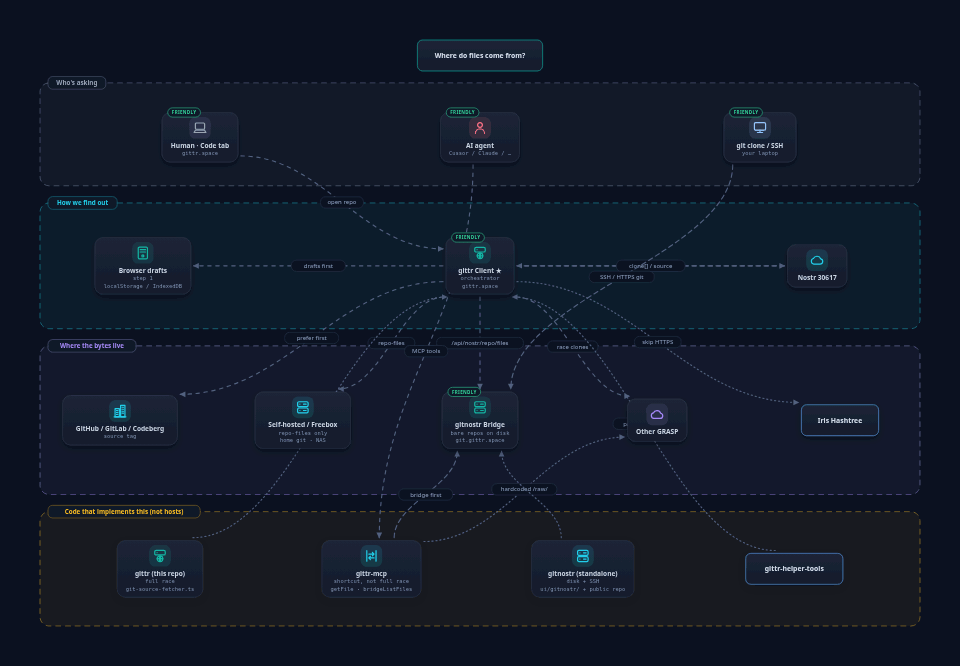

# [gittr.space](https://gittr.space)

**gittr** is a website for git on Nostr ([NIP-34](https://gittr.space/nostr-git)). Issues, pull requests, and the repo announcement are signed events. The git files sit on the Nostr git servers listed under **Nostr Backups** on the repo page. gittr is one of those servers when its address is on that list.

Live at [gittr.space](https://gittr.space). [Pages](https://pages.gittr.space) · [Apps](https://gittr.space/apps) · [Relay](https://relay.gittr.space) · [Help](https://gittr.space/help) · [Legal](https://gittr.space/legal) · [Nostr schemata](https://gittr.space/npub1zafcms4xya5ap9zr7xxr0jlrtrattwlesytn2s42030lzu0dwlzqpd26k5/schemata?file=README.md)

Docs: [gittr-docu](https://3un05jr4dnwh6njreq6uhzgv67st83jxi5lnpsbf8y3dkdq1qkgittr-docu.pages.gittr.space/) · cookbook [gittr-snips](https://3un05jr4dnwh6njreq6uhzgv67st83jxi5lnpsbf8y3dkdq1qkgittr-snips.pages.gittr.space/)

## How it compares

Classic forges, typical Nostr git clients, and gittr. **✓** means it has it. A word means how that column does the job.

| | oldschool gits | nostr git clients | gittr |
| --- | --- | --- | --- |
| Public or private | ✓ | ✗ | ✓ |
| Pull requests and issues | ✓ | ✓ | ✓ |
| Version control, branches | ✓ | CLI writes, web mostly reads | ✓ on the site and over git |
| Releases | assets on the forge | shows them | create and push a release |
| Release assets | per repo | shows them | push and browse Apps, Push to Zapstore |
| Pages | ✓ | ✗ | push, link on the repo, browse |
| Discussion boards | ✓ | ✗ | ✓ |
| Project and milestone planning | ✓ | ✗ | add open issues to a board |
| Notifications, follow, watch | ✓ | ✗ | usual alerts, plus early and CVE alerts |
| Account | their login | your Nostr key | your Nostr key, plus other identities and a trust badge |
| Where the git is announced | their servers | you name your own git host | import from those forges; clone addresses are Nostr Backups |
| Finding repos | their search | across Nostr | across Nostr, plus normal web search |
| How you use it | website, often an app | CLI writes; web and app mostly read | website, app, and agents (MCP) read and write |
| SSH keys | on their servers | ✗ | in gittr, plus an optional security scan |
| Themes | ✗ | ✗ | ✓ |
| Lightning | ✗ | zaps (address, LNURL, NWC) | LNbits or Blink: zap splits and bounties |
| Architecture and dependencies | ✗ | ✗ | ✓ |
| Dependency lab | ✗ | ✗ | ✓ |

- **oldschool gits** — GitHub, GitLab, Codeberg, Gitea, and the like. One site holds the account, the files, and the search.
- **nostr git clients** — ngit, gitworkshop, gitplaza, and similar. Same Nostr events. You announce your own git host. The site mostly reads; writing git is usually the ngit command line. No private repos, Pages, boards, planning, notifications, or SSH keys in the app.
- **gittr** — the same events, with a website, a phone app, and an agent connection that can read and write. Pages, apps, planning, alerts, and Lightning sit on top. Built on [gitnostr](https://gittr.space/npub1n2ph08n4pqz4d3jk6n2p35p2f4ldhc5g5tu7dhftfpueajf4rpxqfjhzmc/gitnostr?branch=main).

Other tools (nak, gitstr, and the rest) are listed under [Other Nostr git tools](#other-nostr-git-tools). Corrections welcome.

## What you can do

- **Bring a repo over.** Import from GitHub, GitLab, Codeberg, Forgejo, or another git address, then Push to Nostr. **Source** stays that original address. The servers that can serve the files show under **Nostr Backups**.
- **Work only from your computer.** Create the repo, then Push to Nostr, so those same backup addresses exist for other people.
- **Issues and pull requests.** Signed on Nostr. A ticket that was imported from a forge keeps its old number and stays its own row; closing it still happens on that forge. A bounty pays when a gittr pull request is merged here. **To do** on a forge-backed repo shows that forge’s project board. On a Nostr-only repo it can pull open issues onto a board in this browser.
- **Pages.** Publish a static site and browse them at [/pages](https://gittr.space/pages).
- **Apps and releases.** Announce a forge release so it shows on [/apps](https://gittr.space/apps). That lists the app. It does not put the installer into the git files. A “new listing” note on the Releases tab stays in this browser until you announce. [Help → Releases](https://gittr.space/help#releases).
- **Phone.** A thin app around the website, for Zapstore and F-Droid. Details: [android-app/README.md](android-app/README.md).
- **Bounties.** Fund an issue with Lightning.
- **Home.** Latest public repos, apps, pages, and activity. Same list signed in or out.
- **Phone home screen.** Two tiles: busy Nostr git repos, and the newest apps. Add them at [gittr.space/omalauncher](https://gittr.space/omalauncher).
- **Agents.** [gittr-mcp](https://gittr.space/npub1n2ph08n4pqz4d3jk6n2p35p2f4ldhc5g5tu7dhftfpueajf4rpxqfjhzmc/gittr-mcp) talks to the same site over HTTP and Nostr.

If the git host in **Source** is gone, the steps are on [Help](https://gittr.space/help#when-source-goes-offline). Confirm a Nostr Backups address before you treat it as a copy.

**If Chrome asks to “access devices on your local network”:** block it. gittr.space does not need that. A home address had landed in a relay list or a repo announcement.

## Where the pieces are

Interactive map: [docs/gittr-platform.netdraw.json](docs/gittr-platform.netdraw.json) · still frame [docs/gittr-platform.png](docs/gittr-platform.png). Bridge diagrams: [gitnostr](https://gittr.space/npub1n2ph08n4pqz4d3jk6n2p35p2f4ldhc5g5tu7dhftfpueajf4rpxqfjhzmc/gitnostr?branch=main).

How the Code tab picks a server: [FILE_FETCHING_INSIGHTS.md](docs/FILE_FETCHING_INSIGHTS.md).

| Piece | Where | Job |
| --- | --- | --- |
| **gittr** (this repo) | [gittr](https://gittr.space/npub1n2ph08n4pqz4d3jk6n2p35p2f4ldhc5g5tu7dhftfpueajf4rpxqfjhzmc/gittr?branch=main) · `gittr.space` | The website |
| **gitnostr** | [gitnostr](https://gittr.space/npub1n2ph08n4pqz4d3jk6n2p35p2f4ldhc5g5tu7dhftfpueajf4rpxqfjhzmc/gitnostr?branch=main) · `git.gittr.space` | Git over SSH and HTTPS |
| **Pages** | [nsite-gateway](https://gittr.space/npub1n2ph08n4pqz4d3jk6n2p35p2f4ldhc5g5tu7dhftfpueajf4rpxqfjhzmc/nsite-gateway) · `pages.gittr.space` | Static sites |
| **Blossom** | [gittr-blossom](https://gittr.space/npub1n2ph08n4pqz4d3jk6n2p35p2f4ldhc5g5tu7dhftfpueajf4rpxqfjhzmc/gittr-blossom?branch=master) · `blossom.gittr.space` | Files for Pages and app listings |
| **Relay** | [pyramid](https://gittr.space/npub1n2ph08n4pqz4d3jk6n2p35p2f4ldhc5g5tu7dhftfpueajf4rpxqfjhzmc/pyramid) · `relay.gittr.space` | Forge relay |
| **gittr-mcp** | [gittr-mcp](https://gittr.space/npub1n2ph08n4pqz4d3jk6n2p35p2f4ldhc5g5tu7dhftfpueajf4rpxqfjhzmc/gittr-mcp) | The same platform for agents |
| **Snippets** | [gittr-helper-tools](https://gittr.space/npub1n2ph08n4pqz4d3jk6n2p35p2f4ldhc5g5tu7dhftfpueajf4rpxqfjhzmc/gittr-helper-tools?branch=main) | Copy-paste bits and the Page cookbook |
| **git remote nostr** | [ngit](https://github.com/DanConwayDev/ngit-cli) | `nostr://` remotes. Same events, different program |

A repo address is a Nostr identity plus a name. Share links look like `Name/repo` and open that same repo. Publish to `wss://relay.gittr.space` and to other relays too.

## Other Nostr git tools

gittr runs **gitnostr**. **ngit** is a separate command-line tool. They read the same Nostr events. Day to day, git push on gittr.space is SSH or HTTPS to a git server, not the ngit program. Side by side: [gitnostr vs ngit](https://gittr.space/npub1n2ph08n4pqz4d3jk6n2p35p2f4ldhc5g5tu7dhftfpueajf4rpxqfjhzmc/gitnostr?branch=main).

| Layer | Project | Role |
| --- | --- | --- |
| Protocol | [NIP-34](https://github.com/nostr-protocol/nips/blob/master/34.md) + [GRASP](https://ngit.dev/grasp/) | Signed repo, issue, and pull-request events. Several git hosts can be listed. |
| Git server | **[gitnostr](https://gittr.space/npub1n2ph08n4pqz4d3jk6n2p35p2f4ldhc5g5tu7dhftfpueajf4rpxqfjhzmc/gitnostr?branch=main)** | The bridge gittr uses. SSH keys, optional push fee. Not ngit. |
| Website | **[gittr](https://gittr.space)** | This repo. [Self-host the bridge](docs/GIT_NOSTR_BRIDGE_SETUP.md). |
| Website | **[gitworkshop](https://gitworkshop.dev)** | Web client that pairs with ngit. |
| Command line | **[ngit](https://ngit.dev)** | `nostr://` remotes. Different code from gitnostr. |
| Desktop | **[gitplaza](https://gitplaza.netlify.app)** | Linux app for repos, issues, patches, releases. No git server of its own. |

Also on the [awesome-nostr git list](https://github.com/aljazceru/awesome-nostr#git), and easy to mix up:

| Project | What it is |
| --- | --- |
| [nak](https://github.com/fiatjaf/nak) | General Nostr command line. `nak git` clones and pushes NIP-34 repos. |
| [gitstr](https://github.com/fiatjaf/gitstr) | Old patch tool. Use `nak git` instead. |
| [git-nostr-tools](http://git.jb55.com/git-nostr-tools) | Sends code patches over Nostr. |
| [git-nostr](https://github.com/colealbon/git-nostr) | Early command-line experiment. Its own event tags. |
| [gittr-helper-tools](https://gittr.space/npub1n2ph08n4pqz4d3jk6n2p35p2f4ldhc5g5tu7dhftfpueajf4rpxqfjhzmc/gittr-helper-tools?branch=main) | Snippets and a Page cookbook. Not a forge. |
| [gittr-mcp](https://github.com/arbadacarbaYK/gittr-mcp) | Agent connection for Cursor, Claude, and the like. |
| [Zapounty](https://github.com/ZigBalthazar/zapounty) | Lightning bounties on GitHub issues. Not a Nostr git client. |
| [NostrGit](https://github.com/NostrGit/NostrGit) | Old website template. Not the git server gittr runs. |

### Ways to reach the git

| Way | On gittr.space | Note |
| --- | --- | --- |
| SSH or HTTPS | yes | `git@git.gittr.space:<npub>/repo.git` — [SSH guide](docs/SSH_GIT_GUIDE.md) |
| Your own gitnostr | yes | Same code. [Bridge setup](docs/GIT_NOSTR_BRIDGE_SETUP.md) |
| `gn` command | yes | Publish from a terminal. The bridge watches relays. |
| `nostr://` | works if you install it | Needs [git-remote-nostr](https://github.com/DanConwayDev/ngit-cli) on your machine. gittr does not ship ngit. [Help](https://gittr.space/help) |
| Iris `htree://` | recognized | Shown in the sidebar. Opening the tree needs `git-remote-htree`. |
| `nak git` | install it yourself | Same events, different command. |
| Agents | yes | [gittr-mcp](https://github.com/arbadacarbaYK/gittr-mcp#install-5-minutes). Not SSH. |

## Also on the site

- **Import** copies a repo onto your Nostr identity (you own it). **Fork** is a new repo that keeps a “forked from” line and the parent’s files. A GitHub address on an import is where it came from.
- **Delete repository** is signed by the owner.
- Discussions, notifications (Nostr or Telegram), Watch, and Star.
- Optional dependency check, and private early / CVE alerts. Those alerts are not posted as a public issue.
- Repo zaps, a zap split with contributors, and an optional fee on push.
- Explore, a profile page (that person’s repos, Pages, and apps), trust badges, and verified identities (GitHub, X, and others).
- **Lab** in the header is a snapshot of dependencies around gittr. A single repo’s CVEs stay on that repo’s Dependencies tab.
- Snippets, themes, and install-as-app.

Setup and edge cases live in [docs/](docs/). Search and public URLs: [docs/SEO.md](docs/SEO.md).

## Stack

| Layer | Tech |
| --- | --- |
| Website | Next.js 16, React 19, TypeScript, Tailwind |
| Nostr | `nostr-relaypool`, `nostr-tools` |
| Git server | `git-nostr-bridge`, `git-nostr-ssh`, `git-nostr-cli` in [ui/gitnostr/](ui/gitnostr/) |
| App and Page files | Blossom. Git objects stay on the git servers. |
| Payments | Lightning zaps, LNbits, NWC, LNURL |

## Files

- The announcement is on relays. The git files are on the servers in that announcement (**Nostr Backups**). `git.gittr.space` is one of them when it is listed.
- The browser keeps your keys. The website does not store your Nostr or Lightning secrets. Clearing the browser does not unpublish a repo. The live announcement is what counts. Phone sign-in (Amber, Primal): [NIP46_REMOTE_SIGNER_INTEGRATION.md](docs/NIP46_REMOTE_SIGNER_INTEGRATION.md).
- Notification files on the server stay there. Do not copy them up from a laptop. [SETUP_INSTRUCTIONS.md](docs/SETUP_INSTRUCTIONS.md).
- A very large import can fail (the cap is about 4 MB). Leave big binaries out, or import a smaller slice.
- The first import copies the forge history. A later Push from the website, or from an agent, saves one new snapshot of the files. To add commits on top of the old history, `git push` over SSH. [SSH guide](docs/SSH_GIT_GUIDE.md).

Deploy: [SETUP_INSTRUCTIONS.md](docs/SETUP_INSTRUCTIONS.md) or a local website plus [LOCAL_SETUP.md](docs/LOCAL_SETUP.md). Ops checklist: [DEPLOYMENT_GUIDE.md](docs/DEPLOYMENT_GUIDE.md).

## Docs

- [SETUP_INSTRUCTIONS.md](docs/SETUP_INSTRUCTIONS.md) — production
- [LOCAL_SETUP.md](docs/LOCAL_SETUP.md) — on your machine
- [DEPLOYMENT_GUIDE.md](docs/DEPLOYMENT_GUIDE.md) — ops
- [SSH_GIT_GUIDE.md](docs/SSH_GIT_GUIDE.md) — `git clone` and `git push`
- [GRASP_RELAY_SETUP.md](docs/GRASP_RELAY_SETUP.md) — your own relay
- [NIPS_AND_EVENT_KINDS.md](docs/NIPS_AND_EVENT_KINDS.md) — event kinds
- [NIP46_REMOTE_SIGNER_INTEGRATION.md](docs/NIP46_REMOTE_SIGNER_INTEGRATION.md) — phone sign-in

## Roadmap

- Clearer branches and tags, pull-request conflicts, a commit graph, better search ranking
- Shortcuts, line links, a CI view, VS Code links
- More security hardening

## License

- This website: **AGPL-3.0** — [ui/LICENSE](ui/LICENSE).
- [ui/gitnostr/](ui/gitnostr/): **MIT** — [ui/gitnostr/LICENSE.md](ui/gitnostr/LICENSE.md).

## Lineage

| Project | Role |
| --- | --- |
| [gitnostr](https://gittr.space/npub1n2ph08n4pqz4d3jk6n2p35p2f4ldhc5g5tu7dhftfpueajf4rpxqfjhzmc/gitnostr?branch=main) | Git server. Lives in [ui/gitnostr/](ui/gitnostr/) in this repo. |
| **gittr** | This repo. The website on top of that server. |
| [NostrGit](https://github.com/NostrGit/NostrGit) | Old website template. Not the git server. |

Also [nostr-relaypool](https://github.com/adamritter/nostr-relaypool) and [GRASP](https://ngit.dev/grasp/). Picture: [docs/gittr-platform-enhancements.png](docs/gittr-platform-enhancements.png).

## Support

Telegram: [https://t.me/gittrspace](https://t.me/gittrspace)

Nostr: [https://njump.me/npub1nur7st367ys7cqtjyv74alu84y209zsw8wagpxvrl3g9q2veqzuqjqh65s](https://njump.me/npub1nur7st367ys7cqtjyv74alu84y209zsw8wagpxvrl3g9q2veqzuqjqh65s)
